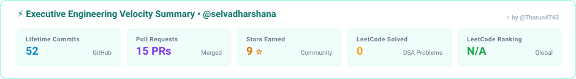
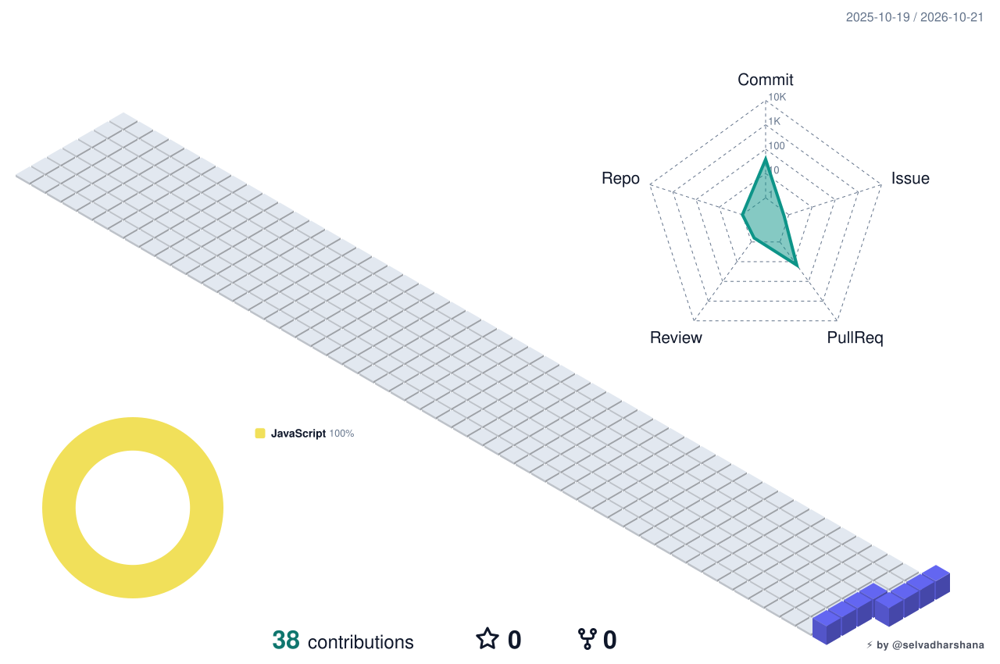
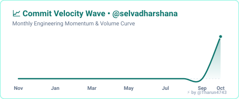
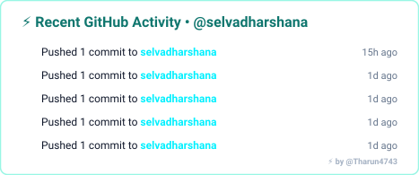
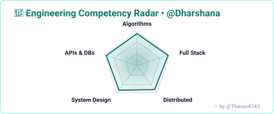
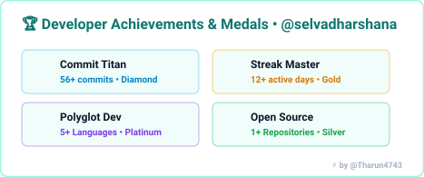
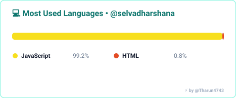
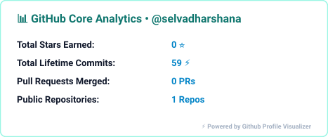
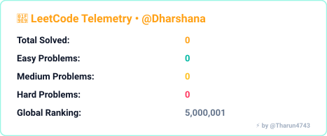
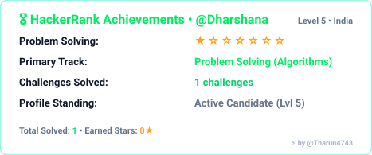

# Hi, I'm Dharshana 👋

### B.Sc Computer Science with Cognitive Systems | AI & Intelligent Systems Aspirant

  
  
  

  <a href="https://github.com/Dharshana">🌐 <b>GitHub</b></a> ·
  <a href="https://linkedin.com">💼 <b>LinkedIn</b></a> ·
  <a href="https://leetcode.com">🧩 <b>LeetCode</b></a> ·
  <a href="mailto:contact@dharshana.dev">📧 <b>Email</b></a>

---

## ⚡ Academic & Engineering Highlights

* 🧠 **Specialized in Cognitive Systems:** Researching human-like computational models, decision-making systems, and knowledge graphs.
* 🤖 **AI & Intelligent Systems:** Hands-on experience developing ML pipelines, classification models, and neural architectures.
* 📊 **Data Science & Analytics:** Processing structured and unstructured datasets with NumPy, Pandas, and exploratory data analysis.
* 🚀 **Full Stack Foundations:** Constructing responsive web interfaces, modern REST APIs, and automated GitHub CI/CD workflows.

---

## 💻 Featured Projects

* 🧠 **[Cognitive Health Diagnostic Engine](https://github.com/Dharshana):** Predictive analytics model leveraging supervised learning and cognitive feature extraction for healthcare metrics.
* 👁️ **[VisionAI — Real-Time Detection](https://github.com/Dharshana):** Computer vision pipeline utilizing OpenCV and deep learning to identify and classify visual entities in real time.
* 💬 **[Smart Context Conversational Agent](https://github.com/Dharshana):** NLP-driven conversational bot using transformer embeddings to answer domain-specific questions.
* 🌐 **[Cognitive Portfolio & Hub](https://github.com/Dharshana):** Modern high-performance web platform highlighting research projects and developer telemetry.

---

## 🛠️ Skills & Technologies

* **Cognitive Computing & AI:** Machine Learning, Neural Networks, Deep Learning, Natural Language Processing (NLP), Computer Vision, Knowledge Representation
* **Programming Languages:** Python, Java, C++, SQL, JavaScript, R
* **Data Science & Frameworks:** TensorFlow, PyTorch, Scikit-Learn, Pandas, NumPy, OpenCV, PowerBI
* **Web & Backend:** HTML5/CSS3, JavaScript (ES6+), React, Node.js, Express, RESTful APIs
* **Database & Cloud:** PostgreSQL, MySQL, MongoDB, Git, GitHub Actions, Docker, Google Colab

---

## 📊 Telemetry & Engineering Activity

<!-- Executive Summary (Ocean Light) -->

  

<!-- 3D Contribution Skyline (Ocean Light) -->

  

<!-- Telemetry Grid -->
<table border="0" cellpadding="0" cellspacing="4" align="center" width="100%">
  <tr>
    <td width="50%"></td>
    <td width="50%"></td>
  </tr>
  <tr>
    <td width="50%"></td>
    <td width="50%"></td>
  </tr>
  <tr>
    <td width="50%"></td>
    <td width="50%"></td>
  </tr>
  <tr>
    <td width="50%"></td>
    <td width="50%"></td>
  </tr>
</table>

 

### 🐍 365-Day Contribution Snake

<picture>
  <source media="(prefers-color-scheme: dark)" srcset="assets/github-contribution-grid-snake-dark.svg">
  <source media="(prefers-color-scheme: light)" srcset="assets/github-contribution-grid-snake.svg">
  
</picture>

  

